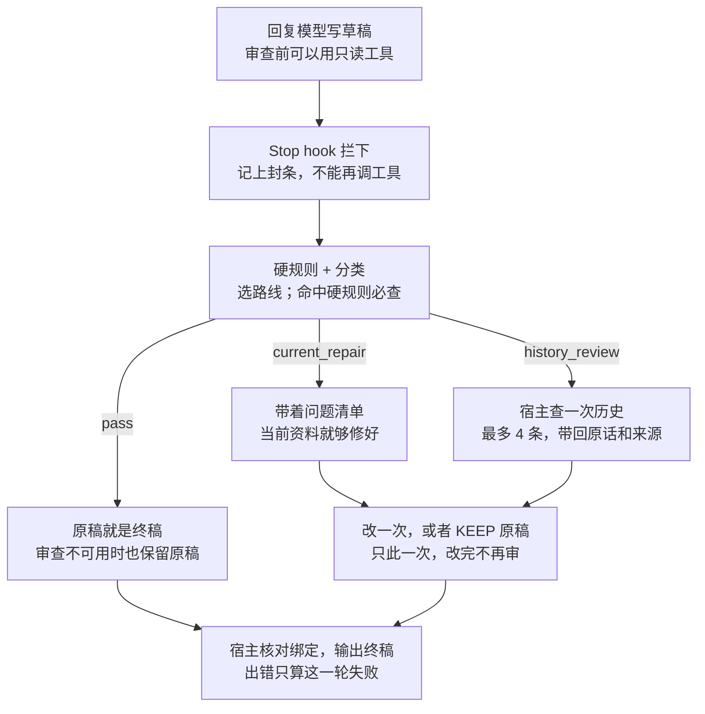

# 设计思路和一轮怎么走

审查是回复发出之前的最后一道检查：草稿写完先不发，另一个模型挑问题，宿主去查证据，助手最多改一次。这一页讲为什么这样设计；怎么接线见仓库根目录的 README 和 PDF。

## 为什么要审查

它专门拦下面四种错：

- **编往事**：把没发生过的共同经历、旧承诺、过去进展说得像真的。
- **问已知**：反问用户早就说过的事，比如宠物的品种、生日。
- **说忘了**：明明记录里有，却说「不记得」「翻不到」。
- **报假账**：没有工具回执，却说「我已经发了」「已经存好了」。

只靠提示词拦不住这些。写回复的模型最自信的时候，往往正是它在补全空白的时候，叫它「别编」，它也看不出自己在编。所以审查交给另一个只看草稿的模型，查证据交给宿主，规矩记在宿主的数据库里，而不是写在提示词里求模型自觉。

### 召回和审查的分工

我们最早做审查，是因为一个很具体的现象：助手专门写过记忆卡，记着用户的猫是什么品种、什么毛色，可它自己在话里提起那只猫时，还是会说错或者反过来问。

卡是有的，问题出在**召回是按用户说的话去找的**。用户提到那只猫，卡就会被带进来；用户没提、是助手自己在话里带出来，召回根本不知道该去找，助手就只能凭印象写。承诺也一样：助手自己说了「我保证」，召回不会因此去把以前的保证找来。

所以：

> **召回按用户说的话找，审查按助手要说的话找。**

草稿里自己带出的名字、往事和承诺，要在发出去之前拿草稿去查一遍。

## 设计原则

一句话：写回复的只管写，挑问题的只管挑，查证据和守规矩的是宿主。

1. **宿主守规矩，不靠模型自觉**。封条、只改一次、草稿和终稿的绑定，都记在宿主的 SQLite 账本里。模型就算想绕，也绕不过去。
2. **审查模型只挑问题，不动手改稿**。它只输出路线和问题清单，每条问题必须引用草稿里的原文片段。改稿还是原来那个模型自己来，语气和人设不变。
3. **证据由宿主去查**。需要翻历史的地方，宿主在审查阶段就查好，把原话连同来源和日期递过去。模型不用，也不能再自己去翻。
4. **只改一次，审查后封工具**。不然会「改稿 → 调工具 → 再审 → 再改」转好几圈，用户一直看着空白；而且改稿时新查到的东西没人审过。
5. **拿不准就说拿不准**。超时只算「没核到」，不算「查过、没有」；审查不可用时保留原稿并标 `unavailable`，不当作通过。没查到不等于没发生。
6. **当下的话优先**。用户这一轮或最近说的话、真实工具回执已经能解决的，直接用，不去翻旧账。旧的助手发言只证明「说过」，不证明事情发生过。
7. **宿主不同，规则一份**。Claude Code 和 Codex 两个宿主共用同一份审查说明、契约和硬规则。

## 一轮怎么走

三条路线里只有 `history_review` 会去查历史。不管走哪条，助手最多改一次；选 KEEP 时由宿主把原稿还原回来。草稿、KEEP 控制记录和证据包都不会当正文输出。

## 宿主自己抓的：三道硬规则

审查模型也会漏。下面三类句子长相固定，宿主用规则直接抓，一命中就强制查一次历史。

| 草稿里出现 | 宿主拿什么去查 | 每轮上限 |
| --- | --- | --- |
| 「不记得」「没印象」「找不到」 | 说忘了的那个名字 | 4 个名字 |
| 「是猜的」「没去翻」「还没查」 | 猜的那件事 | 2 条 |
| 反问已知的稳定事实：品种、名字、生日、毛色、长相、年龄 | 只用名字（代词对到最近的名字） | 2 条 |

- **查询只用名字**。我们踩过的坑：拿「名字 + 品种」去查，检索不把它当名字，返回的材料变少，答案那张卡没挤进来；只查名字，卡就在里面。所以属性词只用来给查到的证据排序，不放进查询。
- **不会误伤**。规则只认名字和代词。「你今天想吃什么」这种普通问句、用户这一轮才第一次介绍的新对象，都不会命中。用户和助手的称呼、宠物名写在安装时生成的 `persona.local.json` 里。

### 冰箱贴

冰箱贴是用户写给助手的固定提醒，是用户的原话，不是模型总结的规则。新安装一张都没有。

- 每张有触发词。草稿碰到触发词、又违反了这张的意思，就必须改。命中的最多 2 张，跟唯一一次修订材料一起送到，不多起一次模型调用。
- 原文原样交给助手，不改写、不摘要。正文最多 180 字，最多 128 张；修改要带版本号，冲突会被拒绝。
- 助手这边没有写冰箱贴的工具：贴什么，只有用户能定。

## 证据从哪来

本包不绑定任何记忆系统。要查历史时，宿主向你自己实现的召回接口发一次请求（协议见 [INTERFACE.md](../INTERFACE.md)）：

- 每轮最多一次请求、1–4 条查询，每条都锚在草稿的一段原文上；查询必须简短、中性，不能预填答案。
- 返回 `ok`（1–12 条证据）、`no_match` 或 `unavailable`。三者分开记：没查到不代表没发生，查不了也不代表查过。
- 请求和响应用三个 ID 加请求体 SHA-256 绑定，防止串轮；材料是不是真的，由你的召回服务负责。
- 召回服务必须只读，权限由它自己判断，不能因为请求里的 scope 就放宽。
- 已经有可信召回的话，可以配置本轮预取（[PREFETCH.md](../PREFETCH.md)）：主回复前先取一份材料，审查对同一 scope、规范化后完全相同的查询直接复用，不再查第二次。

查到的是「当时说过的话」，不等于核实过的答案。计划、设想、引语不能升级成已经发生；用户当下的纠正永远优先。

## 时限和失败

审查卡在用户和回复中间，多等一秒用户就多看一秒空白，所以每一步都封顶。

| 环节 | 上限 |
| --- | --- |
| Stop hook（Claude 宿主） | 38 秒 |
| 审查分类，单次请求 | 20 秒；同时最多 2 个；不重试 |
| 召回 / 预取 | 各 8 秒，不重试 |
| 整轮 | 默认 180 秒，可设 5–900 |

- **超时只算「没核到」**，不算「查过、没有」。草稿不会因为超时被改成不确定的说法，也不能借超时编出相反的事。
- **失败只算这一轮**。CLI 超时、撞封条、没有 Stop、草稿绑定不符，都只把这一轮记为失败，不输出草稿，也不自动重放。下一条照常发。
- **审查材料不留在会话里**。Claude 子进程用不持久化的会话，Codex 每轮用临时 home，结束后整轮清理。下一轮只带已完成的用户原话和终稿。材料仍会发给你选的审查模型服务。

## 从真实问题里学到的

这些规矩大多是踩坑踩出来的：

- **撞封条不能锁会话**。草稿里写「我这就去查」，审查后模型真去调工具，撞上封条。早期这会把整个会话锁住，后来改成只让这一轮失败。所以人格提示里最好写清楚：要用的工具先用完，再写草稿；草稿里不要承诺「待会去查」。
- **失败要有证明**。每一种失败都要能证明是哪一段、为什么失败，才把那一段排除掉；证明不了的才停下来等人处理。
- **逐字核对要当心空白**。审查选了保留原稿，原稿结尾多一个空格，和存下的终稿对不上，之后的消息就都卡住了。
- **配置名单别写死**。审查开没开要按会话前缀匹配，写死一个会话 ID，换了新窗口审查就悄悄不跑了，而且很难发现。

## 还没解决的

- 草稿不是问，而是直接说错已知的事（比如把用户的猫说成另一个品种），没有规则兜底，只能靠审查模型自己认出这是「已知的个人信息」。
- 承诺只能被认出来，数不了。审查认得「我保证」「下次一定」「以后不会」这类话，但不知道这是第几次，也对不上以前保证过什么。
- 「拒绝工具但让这一轮正常收尾」还没做，现在撞封条就是这一轮失败。
